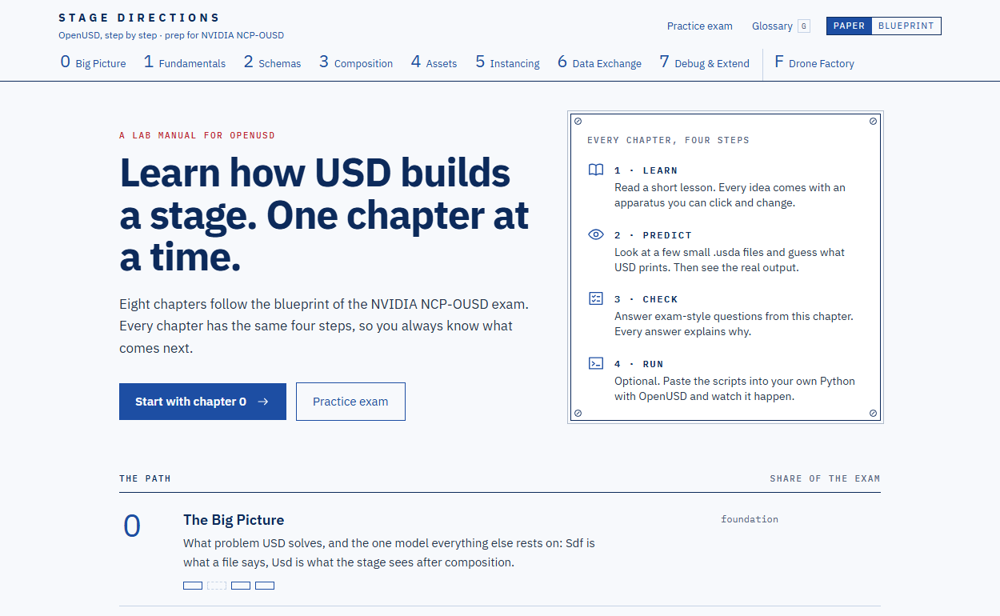

# Stage Directions

Learn OpenUSD step by step. Lessons you can play with, predictions checked on real USD,
and exam practice for the **NVIDIA-Certified Professional: OpenUSD Development (NCP-OUSD)** certification.

This is my private side project. I made it for my own study and share it for free.
The code and the content were written by the AI model Claude (Anthropic) at my direction –
see [How the content was made](#how-the-content-was-made).

**Open the app:** <https://pawelkikta.github.io/stage-directions/>



## What it covers

The app has eight chapters (0–7). They follow the modules of
[Learn OpenUSD](https://docs.nvidia.com/learn-openusd/) and the topic areas of the exam:
the big picture, scene description fundamentals, schemas, composition, asset structure,
instancing, data exchange, and customizing and debugging.

Each chapter has four steps:

- **Learn** – a lesson with small interactive models: the LIVERPS tracer, a layer stack,
  a composition arc playground, a variant switcher, an instancing view and more.
- **Predict** – a situation with `.usda` files and a short Python script. You guess what real USD prints,
  then you see the real output. Some situations ask you to find the bug.
- **Check** – exam-style questions with explanations.
- **Run** – optional: the same ideas as scripts for your own Python with OpenUSD.

Also in the app:

- **Practice exam** – 65 questions in 120 minutes from a bank of 220, weighted by the exam topics,
  with a score per topic.
- **Drone Factory** – a final project: a digital twin of a small factory, built from USD in nine steps
  and shown in 3D. At the end you get the whole factory as one `.usdz`.
- **Glossary** and a **concept map** that shows how the ideas connect.
- **Set up OpenUSD** – how to get Python with OpenUSD running, and all Lab scripts in four tracks.

Your progress stays in your browser (`localStorage`). The app sends no data and has no analytics.

## Install as an app

The app is a PWA: you can install it from the browser. After the first visit it works offline.

- **Windows, macOS, Linux** – open the page in Chrome or Edge and click the install icon at the end of
  the address bar (or choose "Install…" in the browser menu).
- **Android** – in Chrome, open the ⋮ menu and choose "Install app" or "Add to Home screen".
- **iPhone and iPad** – in Safari, tap "Share", then "Add to Home Screen".

A new version loads by itself on the next visit. Your progress stays.

## Run it locally

You need Node.js 20.19+ or 22.12+.

```bash
npm ci
npm run dev
```

The production build goes to `dist/`:

```bash
npm run build
npm run preview
```

Stack: React 19, Vite, TypeScript, Tailwind CSS 4, zustand, React Flow, framer-motion, three.js
(only on the Drone Factory page), vite-plugin-pwa. The fonts come from npm packages,
so the app does not connect to Google Fonts.

Publishing: the workflow [`.github/workflows/pages.yml`](.github/workflows/pages.yml) builds the app
and deploys it to GitHub Pages after every push to `main`.

### Checking the content on real USD

The outputs in the Predict steps, the Lab and the Drone Factory come from real OpenUSD 25.08.
Three scripts run everything again and compare or save the results:

```bash
npm run verify:sandbox   # Predict situations -> src/data/sandbox.verified.ts
npm run verify:lab       # Lab scripts, compared with the expected output
npm run verify:factory   # Drone Factory -> src/data/factory.verified.ts, factory.usdz, render
```

They need Node.js 22.18+ (they run TypeScript directly) and the OpenUSD binaries with Python.
By default they look in `~/Documents/usdview`; set `USD_ROOT` to use another folder.
If a situation or a factory step changes after verification, the app shows a note that its output
must be checked again.

## How the content was made

The lessons, questions, situations, scripts, glossary and code were written by the AI model
**Claude** (Anthropic) at my direction, while I studied for the exam. I chose the scope, asked the questions,
reported mistakes and decided on the fixes. Checking was also done with the help of Claude:

- **Lessons** were compared with [Learn OpenUSD](https://docs.nvidia.com/learn-openusd/) and the
  [OpenUSD documentation](https://openusd.org).
- **Every Predict situation, every Lab script and every Drone Factory step** was run on OpenUSD 25.08.
  The outputs in the app were recorded from those runs, not written by hand.
- **The renders** in the lessons were made with `usdrecord` from the scenes the lessons describe.

This is not an expert review. Use the app as a study aid, not as a source.

## Disclaimers

- This project is **not affiliated with or endorsed by** NVIDIA, Pixar or the Alliance for OpenUSD (AOUSD).
- The practice questions are written for practice. They are **not** questions from the real exam.
- The content was written by an AI model and can contain mistakes, also ones I did not catch.
  Before the exam, check the current official documentation and the
  [exam page](https://www.nvidia.com/en-us/learn/certification/openusd-development-professional/).
- NVIDIA, Omniverse and NCP-OUSD are trademarks of NVIDIA Corporation. USD and OpenUSD are projects of Pixar
  and the Alliance for OpenUSD. All marks belong to their owners.
- Found a mistake? Report it in [Issues](https://github.com/pawelkikta/stage-directions/issues),
  if you can with a link to the documentation or a short script that shows the behavior.

## License

- Code: [MIT](LICENSE).
- Educational content (lessons, questions, situations, scripts, glossary, renders):
  [CC0 1.0](LICENSE-CONTENT.md) – public domain, you can use it without conditions.
- Fonts (`@fontsource` packages): IBM Plex Sans and IBM Plex Mono – SIL Open Font License 1.1.
- The chapter order follows [Learn OpenUSD](https://github.com/NVIDIA-Omniverse/LearnOpenUSD)
  (NVIDIA, Apache-2.0).

## Author

Paweł Kikta – [github.com/pawelkikta](https://github.com/pawelkikta)
